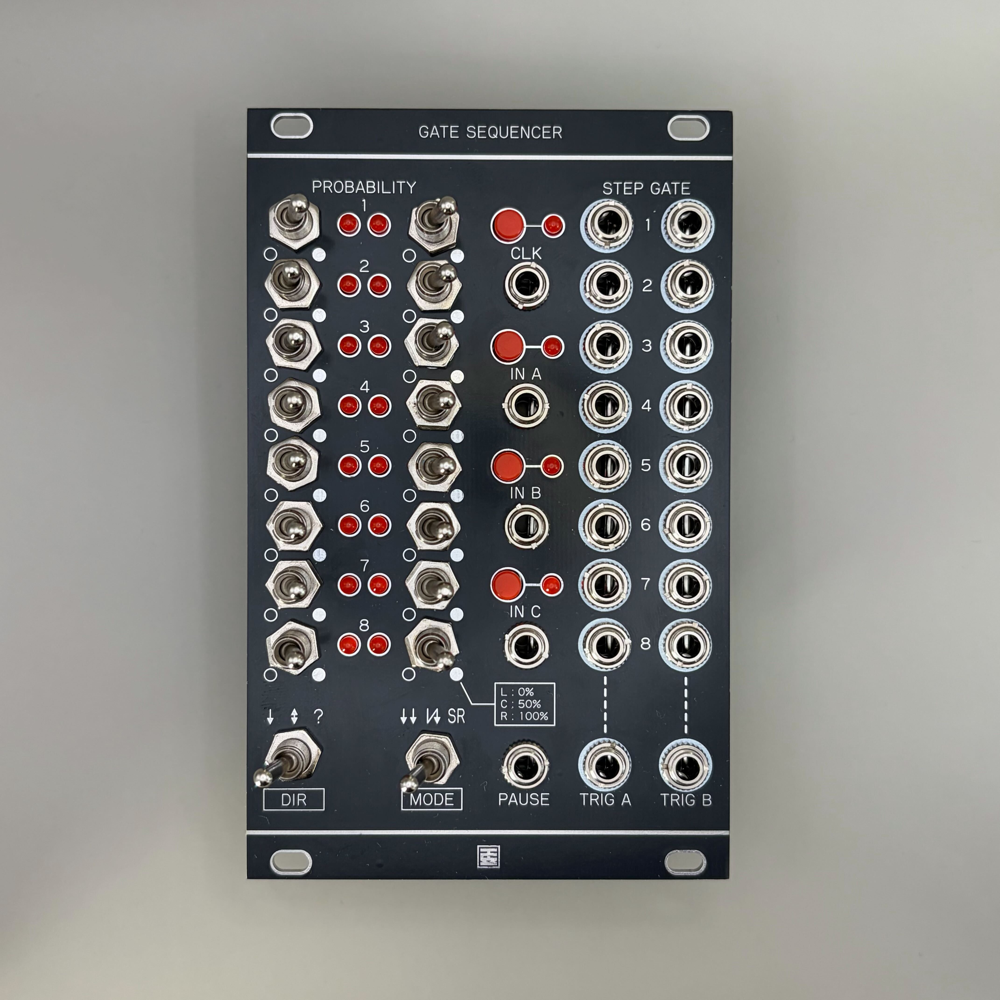
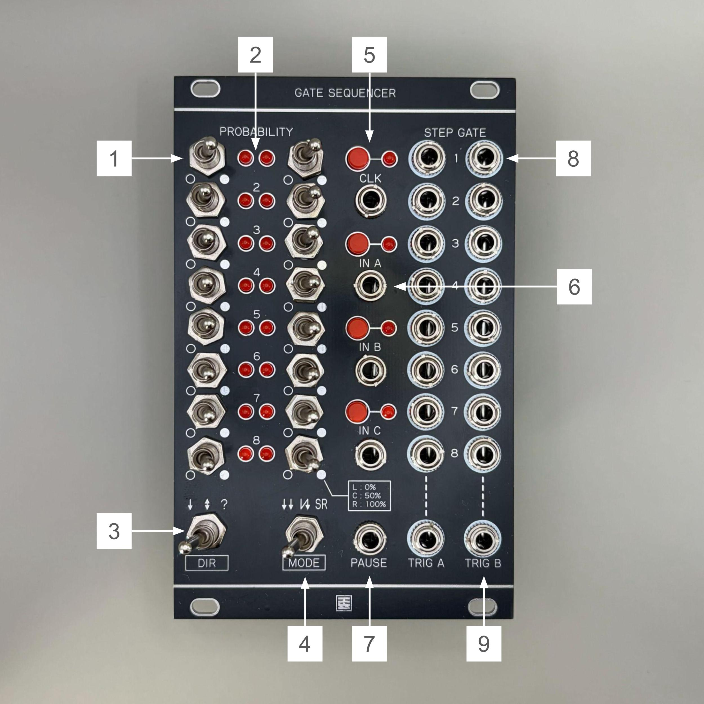

# Gate Sequencer マニュアル（日本語）

## 概要

**Gate Sequencer** は、トグルスイッチ式の多機能ゲートシーケンサーです。   
・独立した2つのクロックで動く **8 Stepシーケンサー x2**  
・パフォーマンス機能を備えた **16 Stepシーケンサー**  
・可変長・経路変更可能な **シフトレジスタ (Turing Machine)**  
の3つの機能を備え、スイッチ一つで切り替えて使用できます。

---

## 仕様

- **フォーマット**：Eurorack  
- **幅**：16 HP  
- **奥行き**：25 mm  
- **消費電流**：+12V: 50mA / -12V: 0mA  

> ※ ケーブルの赤いラインが -12V に接続されていることを確認してください。  
> 誤接続するとモジュールが故障する可能性があります。  
> **電源投入前にケーブルの向きを必ずご確認ください。**

---

## 各部の機能

1. **Probability Switch (1-16)**  
   各ステップの挙動を設定する3ポジショントグルスイッチです。  
   **[MODE 1 & 2 (シーケンサーモード) の場合]** ゲートが出力される確率を設定します。  
   - **L** : **OFF** (0%) - ゲートを出力しません。  
   - **C** : **PROB** (50%) - 50%の確率でゲートを出力します。  
   - **R** : **ON** (100%) - 常にゲートを出力します。  
   
   **[MODE 3 (シフトレジスタモード) の場合]**  回路の接続とゲート出力を設定します。  
   - **L** : **SKIP** - そのステップを回路から除外します（シーケンス長が短くなります）。  
   - **C** : **MUTE** - データは通しますが、Gate OUTからは出力しません。  
   - **R** : **ACTIVE** - データを通し、Gate OUTから出力します。

2. **Step LED (1-16)** 
   現在のステップ位置やゲートの状態を表示します。  
   MODE 3では、データの有無を表示します。

3. **Direction Switch** 　
   シーケンスの進行方向を設定します。  
   - **L** : **Forward** - 1 → 16 の順に進みます。  
   - **C** : **PingPong** - 往復動作を行います。  
   - **R** : **Random** - ステップをランダムに移動します。

4. **Mode Switch**  
   モジュールの動作モードを切り替えます。  
   - **L** : **MODE 1** (Dual 8 Step Sequencer)  
   - **C** : **MODE 2** (16 Step Sequencer)  
   - **R** : **MODE 3** (Shift Register)

5. **Clock Button / Clock IN**  
   シーケンスを進めるためのクロック入力です。  
   - **Button** : 手動でクロックを進めます。  
   - **IN** : 外部クロックを入力します。

6. **Button A, B, C / IN A, B, C**  
   選択中のモードによって機能が変化する多機能入力です。  
   - **A** : Fill / Data Input / Clock B など  
   - **B** : Reset など  
   - **C** : Mute / XOR Input / Reset B など  
   （詳細は「動作モード」セクションを参照）

7. **Pause IN**  
   入力がHIGH(+5V)のとき、Clockを無視してシーケンスの進行を一時停止します。

8. **Step Gate OUT (1-16)**  
   各ステップのゲート信号(+5V)を出力します。

9. **Trig A, B OUT**  
   モードに応じた補助的なトリガーや論理信号を出力します。  
   （詳細は「動作モード」セクションを参照）

---

## 動作モード

### MODE 1 : 8×2 Step Sequencer (Dual Mode)
1-8番と9-16番が独立した2系統の8ステップシーケンサーとして動作します。ポリリズムや2声のパターンの作成に適しています。

| 入出力 | 機能説明 |
| --- | --- |
| **SW 1-8** | シーケンサーA (ch.1-8) の確率設定 |
| **SW 9-16** | シーケンサーB (ch.9-16) の確率設定 |
| **IN A / Button A** | **Clock B** : シーケンサーBのクロック入力。 ※ **Button A** を押すと「同期モード」のON/OFFが切り替わります。 ON時(LED A点灯): BはAと同じクロックで進みます。 |
| **IN B / Button B** | **Reset A** : シーケンサーAをステップ1に戻します。 |
| **IN C / Button C** | **Reset B** : シーケンサーBをステップ1に戻します。 ※ **Button C** を押すと「リセット同期」のON/OFFが切り替わります。 ON時(LED C点灯): IN Bへの入力で両方のシーケンサーがリセットされます。 |
| **Trig A OUT** | シーケンサーAのゲート信号を出力 |
| **Trig B OUT** | シーケンサーBのゲート信号を出力 |

---

### MODE 2 : 16 Step Sequencer (Single Mode)
16ステップのシングルシーケンサーとして動作します。ボタン操作によるリアルタイムパフォーマンスに特化しています。

| 入出力 | 機能説明 |
| --- | --- |
| **SW 1-16** | 各ステップの確率設定 |
| **IN A / Button A** | **FILL** : 押している間（入力がある間）、強制的に全ステップのゲートをONにします。 |
| **IN B / Button B** | **RESET** : ステップ1にリセットします。 |
| **IN C / Button C** | **MUTE** : 押している間（入力がある間）、強制的に全ステップのゲートをOFFにします。 |
| **Trig A OUT** | **Inverted Gate** : ゲートがOFFのステップでのみトリガーを出力します。 |
| **Trig B OUT** | **Normal Gate** : ゲートがONのステップでトリガーを出力します。 |

---

### MODE 3 : Shift Register (Turing Machine Style)
入力されたデータを内部の16bitレジスタ内で循環させるモードです。いわゆる「Turing Machine」のようなランダム生成器として動作しますが、**各ステップのスイッチ設定によってビット長や経路が変化する**のが特徴です。

| 入出力 | 機能説明 |
| --- | --- |
| **SW 1-16** | **回路トポロジー設定** **L (Skip)**: そのビットを無視し、前後のステップを直結します（ループ長短縮）。 **C (Mute)**: データは通過しますが、Gate出力はしません。 **R (Active)**: データ通過＋Gate出力。 |
| **IN A / Button A** | **DATA IN** : 新しいデータの入力源です。Button Aを押すと手動で「1」を注入できます。 |
| **IN B / Button B** | **CLEAR** : レジスタの内容を全て0にリセットします。 |
| **IN C / Button C** | **XOR IN / DELETE** :  通常は「IN A」との **XOR (排他的論理和)** を取って次のデータを決定します（これにより変化し続けるパターンが生まれます）。 **Button C** を押している間は、書き込むデータを強制的に「0」にします（パターンの消去）。 |
| **Trig A OUT** | **NOT DATA** : 書き込まれたデータの反転信号を出力します。 |
| **Trig B OUT** | **DATA** : 書き込まれたデータ（XOR結果）を出力します。 |
| **Direction SW** | **PingPong** 選択時は、データ（トークン）が有効なステップ間を往復します。 **Random** 選択時は、スイッチが有効なステップ間の接続順序をランダムにシャッフルします。 |

---

## ライセンス

この作品は [Creative Commons 表示 - 継承 4.0 国際 (CC BY-SA 4.0)](https://creativecommons.org/licenses/by-sa/4.0/deed.ja) の下でライセンスされています。

---

## クレジット

- **Designed by**：StudioKAT  
- **Website**：[https://www.studiokat.jp/](https://www.studiokat.jp/)  
- **GitHub**：[https://github.com/StudioKAT](https://github.com/StudioKAT)  
- **X（旧Twitter）**：[https://x.com/StudioKAT_synth](https://x.com/StudioKAT_synth)  
- **Instagram**：[https://www.instagram.com/studiokat_modular/](https://www.instagram.com/studiokat_modular/)

---

## 更新履歴

- `2025-11-22`：v1.0 リリース