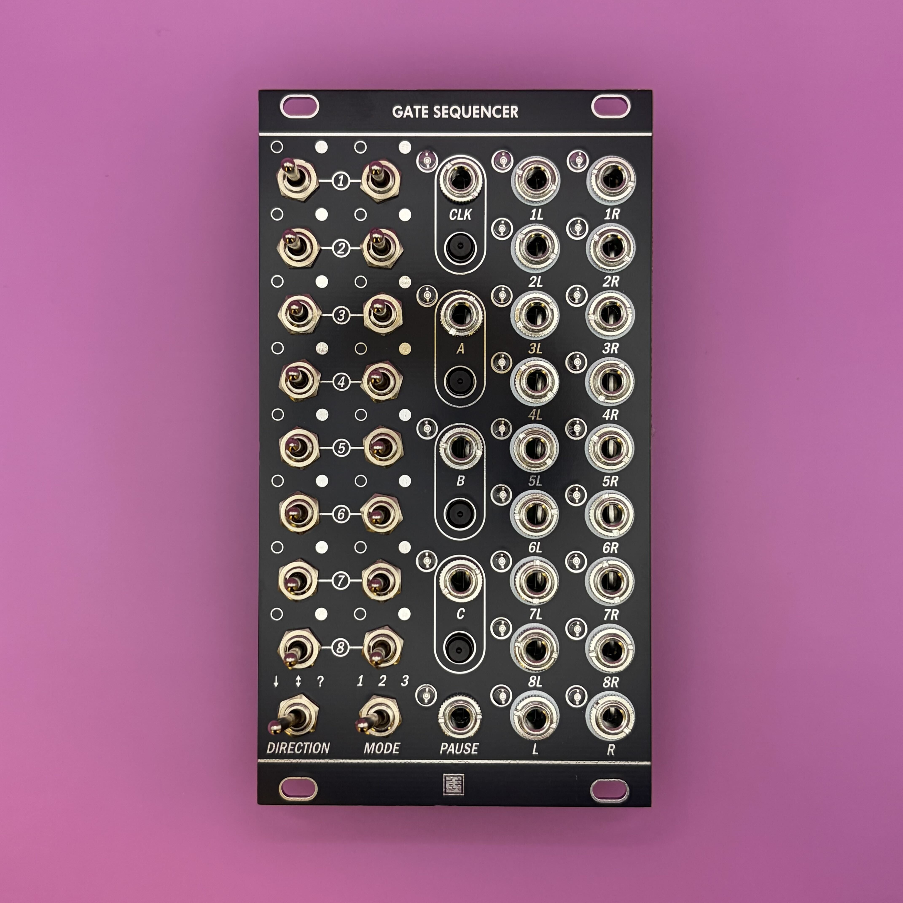
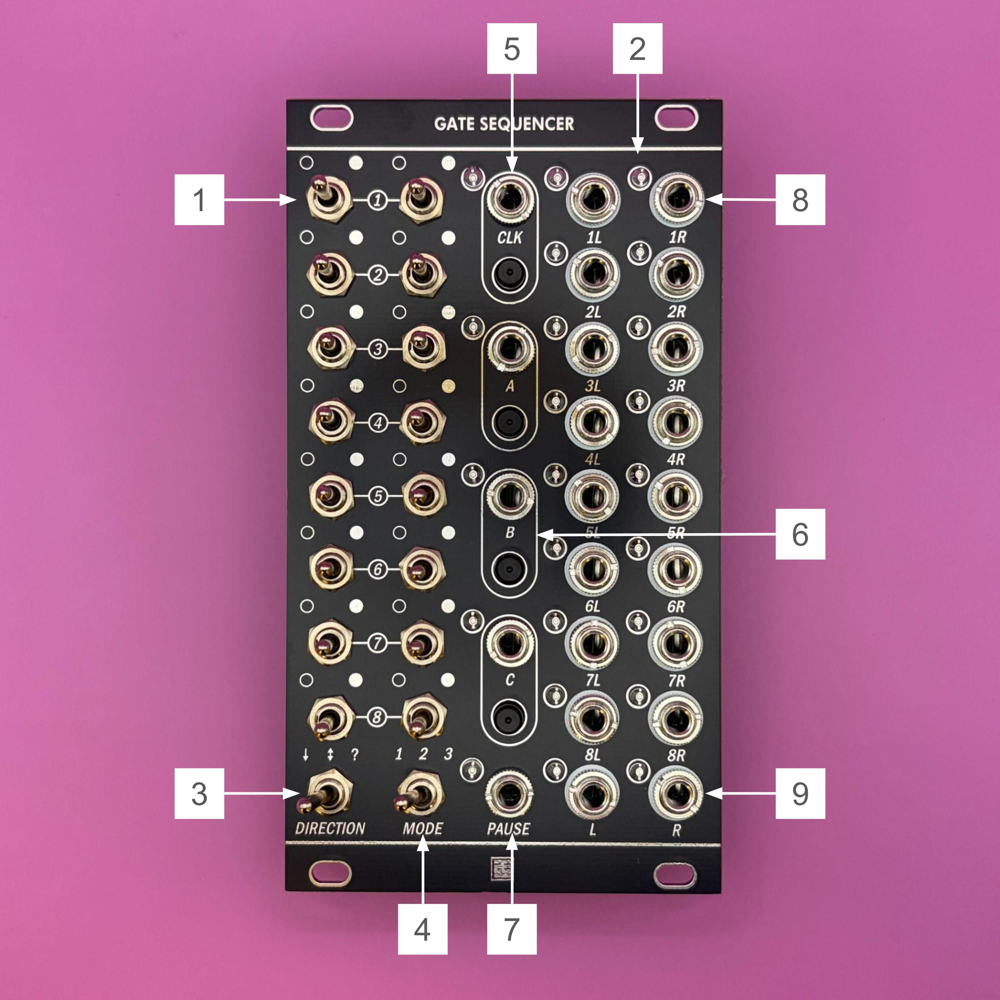

# Gate Sequencer v2.0 Manual (English)



## Overview

The **Gate Sequencer** is a multi-functional gate sequencer equipped with toggle switches. It features three distinct functions that can be switched via a single mode switch:  
* **8-Step Sequencer x2** running on independent clocks.  
* **16-Step Sequencer** with performance features.  
* **Shift Register (Turing Machine)** with variable length and routing capabilities.  


---

## Specifications

- **Format**: Eurorack
- **Width**: 14 HP
- **Depth**: 25 mm
- **Current Draw**: +12V: 50mA / -12V: 0mA
- **Clock Input**: up to 10kHz

> **Note**: Please ensure the red stripe on the ribbon cable is connected to -12V.
> Incorrect connection may damage the module.
> **Always check cable orientation before powering on.**

---

## Functions of Parts



1. **Step Switch (1-16)**
    3-position toggle switches that set the behavior for each step.
    The meaning of L / C / R depends on the mode.

    | Position | MODE 1 (8×2) | MODE 2 (16) | MODE 3 (Shift Register) |
    | :--- | :--- | :--- | :--- |
    | **L** | **PROB** (50%) | **TRIG A** | **MUTE** |
    | **C** | **OFF** | **OFF** | **SKIP** |
    | **R** | **ON** (100%) | **TRIG B** | **ACTIVE** |

    (See the "Operation Modes" section for details.)

2. **Step LED (1-16)**
    Displays the current step position and the gate state.
    - In MODE 1 and 2, the LED of the current step lights up.
      - Full brightness when the step outputs a TRIG, weak brightness when it does not.
    - In MODE 3, the LEDs show the bits that hold data (1).
      - ACTIVE steps light at full brightness, MUTE steps at weak brightness.

3. **Direction Switch**
    Sets the playback direction of the sequence.
    - **L**: **Forward** - Advances from 1 → 16.
    - **C**: **PingPong** - Plays back and forth. The end steps play twice in a row.
    - **R**: **Random** - Picks the next step at random from all steps except the current one.

4. **Mode Switch**
    Switches the operation mode of the module.
    - **L**: **MODE 1** (Dual 8 Step Sequencer)
    - **C**: **MODE 2** (16 Step Sequencer)
    - **R**: **MODE 3** (Shift Register)

    When you change the mode, the sequence restarts from step 1 (in MODE 3, the register is cleared).

5. **Clock Button / Clock IN**
    Clock input to advance the sequence.
    - **Button**: Manually advances the clock.
    - **IN**: Input for external clock.

6. **Button A, B, C / IN A, B, C**
    Multi-function inputs where the function changes based on the selected mode.
    - **A**: Clock B / Fill / Data Input
    - **B**: Reset / Clear
    - **C**: Reset B / Mute / XOR Input
    (See the "Operation Modes" section for details.)

    Holding **Button A and Button B together** while powering on enters the firmware update mode (see "Firmware Update").

7. **Pause IN**
    While the input is HIGH (+5V), the sequence pauses.
    - Clock and reset inputs are ignored, and the TRIG outputs stop.
    - The **Step Gate OUT** keeps the state it had when paused.

    During a firmware update, this jack receives the update audio.

8. **Step Gate OUT (1-16)**
    Outputs gate signals (+5V) for each step.

9. **Trig A, B OUT**
    Outputs triggers or logic signals depending on the mode.
    - The output width follows the HIGH length of the clock. Even with a short clock, the output is at least 3ms wide.
    (See the "Operation Modes" section for details.)

10. **Panel LED**
    Displays the state of the inputs and outputs.

    | LED | Indication |
    | :--- | :--- |
    | **CLK** | Lit while Clock IN is HIGH or the Clock Button is held |
    | **A / B / C** | Lit while IN A/B/C is HIGH or Button A/B/C is held (in MODE 1, also shows the Sync state) |
    | **PAUSE** | Lit while Pause IN is HIGH |
    | **OUT A / OUT B** | Lit while Trig A / Trig B OUT is HIGH |


---

## Operation Modes

### MODE 1: 8×2 Step Sequencer (Dual Mode)
Channels 1-8 and 9-16 operate as two independent 8-step sequencers. This is ideal for creating polyrhythms or two-voice patterns.

| Input/Output | Function Description |
| :--- | :--- |
| **SW 1-8** | Settings for Sequencer A (ch.1-8).<br>**L (PROB)**: Outputs TRIG A with a 50% chance.<br>**C (OFF)**: No TRIG A.<br>**R (ON)**: Always outputs TRIG A. |
| **SW 9-16** | Settings for Sequencer B (ch.9-16). L / C / R work the same as SW 1-8, for TRIG B. |
| **Step Gate OUT** | HIGH on the current step, regardless of the switch position or the probability draw. |
| **IN A** | **Clock B**: Clock input for Sequencer B. |
| **Button A** | Toggles **Sync** ON/OFF.<br>When ON (LED A lit): Sequencer B advances with the Clock (the same clock as Sequencer A) instead of IN A. |
| **IN B / Button B** | **Reset A**: Resets Sequencer A to step 1. While Button B is held, Sequencer A stays on step 1. |
| **IN C** | **Reset B**: Resets Sequencer B to step 1. |
| **Button C** | Toggles **Reset Sync** ON/OFF.<br>When ON (LED C lit): Reset A (IN B / Button B) resets both sequencers. |
| **Trig A OUT** | Outputs a TRIG with the Clock on steps of Sequencer A that passed the probability draw. |
| **Trig B OUT** | Outputs a TRIG with Clock B (or the Clock when Sync is ON) on steps of Sequencer B that passed the probability draw. |

- The Sync and Reset Sync settings are not saved. They are OFF at power-on and are kept when you change the mode.
- When you advance with the Clock Button, a short TRIG is output on steps that passed the probability draw.

---

### MODE 2: 16 Step Sequencer (Single Mode)
Operates as a single 16-step sequencer. Each step's TRIG can be routed to A or B, and the buttons support real-time performance.

| Input/Output | Function Description |
| :--- | :--- |
| **SW 1-16** | TRIG destination for each step.<br>**L (TRIG A)**: Output from Trig A OUT.<br>**C (OFF)**: No TRIG.<br>**R (TRIG B)**: Output from Trig B OUT. |
| **Step Gate OUT** | HIGH on the current step (except during MUTE). |
| **IN A / Button A** | **FILL**: While held (or input is high), treats all steps as R (TRIG B). |
| **IN B / Button B** | **RESET**: Resets to step 1. While Button B is held, the sequence stays on step 1. |
| **IN C / Button C** | **MUTE**: While held (or input is high), treats all steps as C (OFF) and forces the **Step Gate OUT** LOW. Takes priority over FILL. |
| **Trig A OUT** | Outputs a TRIG with the Clock on L steps. |
| **Trig B OUT** | Outputs a TRIG with the Clock on R steps (all steps during FILL). |

---

### MODE 3: Shift Register (Turing Machine Style)
This mode circulates input data within an internal 16-bit register. It operates as a random generator similar to a "Turing Machine," but features **variable bit length and routing changes based on step switch settings.**

| Input/Output | Function Description |
| :--- | :--- |
| **SW 1-16** | **Circuit Topology Settings**<br>**L (Mute)**: Data passes through, but no Gate output is generated (LED at weak brightness).<br>**C (Skip)**: Ignores the bit and connects the preceding/succeeding steps directly (shortens loop length).<br>**R (Active)**: Data passes through and generates a Gate output (LED at full brightness). |
| **Step Gate OUT** | HIGH on ACTIVE steps while their data is 1. |
| **IN A / Button A** | **DATA IN**: Source for new data. While Button A is held, "1" is injected. |
| **IN B / Button B** | **CLEAR**: Resets the register content to all 0s. |
| **IN C** | **XOR IN**: Performs an **XOR (Exclusive OR)** with DATA IN to determine the data to write. |
| **Button C** | **DELETE**: While held, forces the written data to "0" (pattern delete). |
| **Trig B OUT** | **DATA OUT**: Outputs the data at the last step of the path (the exit of the register). |
| **Trig A OUT** | **NOT DATA OUT**: Outputs the inverted signal of Trig B OUT. |
| **Direction SW** | **Forward**: Data advances through the enabled steps (MUTE / ACTIVE) in order from 1 → 16.<br>**PingPong**: Data (tokens) moves back and forth between enabled steps and disappears when it returns to the first step.<br>**Random**: Randomly shuffles the connection order between enabled steps (the first and last steps stay fixed). The order is reshuffled when you change the switch settings or CLEAR. |

> **Making a loop**: Patch Trig B OUT to IN C. The data leaving the register returns to its entrance, and the pattern loops with a period equal to the number of enabled steps. Add data with IN A / Button A, and delete it with Button C.

---

## Firmware Update

The firmware can be updated in either of the following ways.

| Method | What you need | Use |
| :--- | :--- | :--- |
| **Audio** | Update WAV file, a device that can play WAV files, 3.5mm audio cable | Normal updates |
| **WCH-LinkE** | WCH-LinkE (programmer), Windows PC, jumper wires | Recovery when the audio update does not work |

### Updating via Audio

Play a WAV file on a computer or audio interface and feed the sound into **Pause IN**. No dedicated programmer is required.

#### What You Need

- The update WAV file
- A device that can play WAV files. Use one of the following:
  - Line output of an audio interface (recommended)
  - Headphone output of a computer
- A 3.5mm audio cable (from the output of the device → Pause IN)

#### Before Updating

- Set the volume of the playback device to **maximum**.
- **Turn off all sound processing**, such as equalizers, automatic volume adjustment, and spatial audio.
- The update fails if the sound is too quiet. A computer's headphone output may be barely loud enough.
  - If it does not work, use the line output of an audio interface.
  - Or, amplify the sound through a module with gain (a mixer, a VCA, etc.) before feeding it into Pause IN.
- Do not use wireless outputs such as Bluetooth. Connect with a cable.
- Make sure no other sounds (notification sounds, etc.) play during the update.

#### Procedure

1. Turn off the power of the case.
2. Connect the output device to the module's **Pause IN** with the cable.
3. **Hold both Button A and Button B** and turn on the power of the case.
4. When Step LED 1 starts blinking, release the buttons (the module is waiting for data).
5. Play the update WAV file from start to end (about 40 seconds).
    - The PAUSE LED is lit while the module is receiving the sound.
    - The Step LEDs show the progress from left to right.
6. All Step LEDs light for about 2 seconds, and then the module starts with the new firmware. The update is complete.

The module does not work as a sequencer during the update.

#### Troubleshooting

| Symptom | Solution |
| :--- | :--- |
| Step LED 1 does not blink after power-on | Hold both Button A and Button B while turning on the power. Pressing the buttons after power-on does not enter the update mode. |
| The PAUSE LED does not light during playback | The sound is not reaching the module. Check the cable connection (Pause IN) and that the volume is at maximum. |
| The PAUSE LED flickers and the progress does not advance | The sound is too quiet or processed. Set the volume to maximum and turn off sound processing. Use a line output or a module with gain. |
| All LEDs blink | The update failed (sound dropout, WAV for another product, etc.). Keep the power on and play the WAV again from the start. |
| Playback stopped or the power went off during the update | When you turn the power back on, the module waits for data without pressing the buttons. Play the WAV again from the start. |

Even if the update stops partway, the module will not become unusable.
Playing the WAV to the end again completes the update.

### Updating via WCH-LinkE

This method writes the firmware directly to the module's microcontroller with a WCH-LinkE (a programmer made by WCH).
Use it only when the audio update does not work.
This section describes the procedure on Windows with the open-source programming tool **minichlink**.

#### What You Need

- WCH-LinkE
- Windows PC
- 2 jumper wires (WCH-LinkE → J25 on the module)
- The firmware file for WCH-LinkE (`gate_sequencer_factory.bin`)
- The programming tool `minichlink.exe` and `libusb-1.0.dll`
  - They are in the `minichlink` folder of the [ch32fun](https://github.com/cnlohr/ch32fun) repository. Place both in the same folder (e.g. `C:\wch-linke-flash`).
  - The Microsoft Visual C++ Redistributable (x64) is required to run them.

> **Note**: The file to write with the WCH-LinkE is `gate_sequencer_factory.bin`, not the WAV file.
> This file contains the information used for the check at startup. If you write any other `.bin` file, the module waits for data (Step LED 1 blinking) every time it is powered on. In that case, write `gate_sequencer_factory.bin` again.

#### First Time Only: Preparing the WCH-LinkE

1. **Switch to RISC-V mode**
    - Connect the WCH-LinkE to USB. If the blue LED stays lit, it is in ARM mode.
    - Unplug the USB, then **hold the ModeS button** while plugging it in again. The WCH-LinkE switches to RISC-V mode (the blue LED turns off). The mode is remembered.
2. **Install the driver**
    - Start [Zadig](https://zadig.akeo.ie/) and check Options → List All Devices.
    - Select **Interface 0** of the WCH-Link in the list, set the driver to **WinUSB**, and press Install Driver (or Replace Driver).
3. **Check the setup**
    - Connect only the WCH-LinkE to USB and run the following in PowerShell.

    ```powershell
    cd C:\wch-linke-flash
    .\minichlink.exe
    ```

    - If `Found WCH Link` is displayed, the setup is complete (the errors that follow are expected because the module is not connected).

#### Connection

Connect the module's header **J25** to the WCH-LinkE.

| J25 | Signal | WCH-LinkE |
| :--- | :--- | :--- |
| 1 | GND | GND |
| 2 | SWIO | SWDIO |
| 3 | NRST | Not connected |

- J25 has no power pin. **Connect the module to the Eurorack power supply and turn the power on** while writing.
- Do not connect the 3.3V / 5V output pins of the WCH-LinkE to the module.

#### Writing

```powershell
cd C:\wch-linke-flash
.\minichlink.exe -w gate_sequencer_factory.bin flash
```

After writing, turn the power of the case off and on again. When the module starts with the new firmware, the update is complete.

#### Rewriting the Update Mode (Advanced)

If the audio update mode itself (the bootloader) stops working, you can rewrite it with the WCH-LinkE.
Use `bootloader.bin`, distributed together with the firmware file, and run the following three lines in order.

```powershell
.\minichlink.exe -w gate_sequencer_factory.bin flash
.\minichlink.exe -a -U -w bootloader.bin bootloader -b
.\minichlink.exe -w +a55a37c8 option
```

- The third line sets the option bytes so that the module starts from the update mode program at power-on. Enter the value exactly as shown.
- Read it back with `.\minichlink.exe -r + option 16`. If the output starts with `a5 5a 37 c8`, the setting is correct.
- After writing, turn the power of the case off and on again.

---

## License

This work is licensed under [Creative Commons Attribution-ShareAlike 4.0 International (CC BY-SA 4.0)](https://creativecommons.org/licenses/by-sa/4.0/).

---

## Credits

- **Designed by**: StudioKAT
- **Website**: [https://www.studiokat.jp/](https://www.studiokat.jp/)
- **GitHub**: [https://github.com/StudioKAT](https://github.com/StudioKAT)
- **X (Twitter)**: [https://x.com/StudioKAT_synth](https://x.com/StudioKAT_synth)
- **Instagram**: [https://www.instagram.com/studiokat_modular/](https://www.instagram.com/studiokat_modular/)

---

## Update History

- `2026-10-29`: v2.0 Release
  - The overall design has been revised to reduce the width from 16HP to 14HP, making it more compact.  
  - Changed the microcontroller to CH32V003  
  - Changed the L / C / R assignment of the step switches for each mode  
  - MODE 2: TRIG A / TRIG B can be routed per step  
  - MODE 3: Trig A / B OUT now output the data at the exit of the register  
  - Added PAUSE / OUT A / OUT B panel LEDs  
  - Added firmware update via audio  
  - Removed the Config Mode (the Step Gate OUT is fixed to Mode A of v1.x)  
